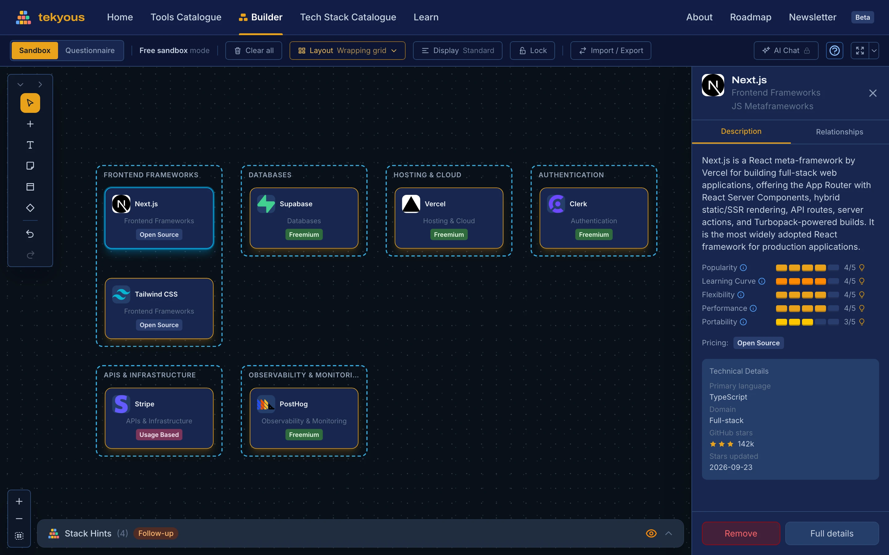

# Tekyous

The interactive tech stack builder and developer tools catalogue. Pick a curated stack or build your own on the
canvas, see how the tools fit together, and compare them by score, pricing, pros and cons.

## Tekyous in your AI agent

- **[agent-skills](https://github.com/tekyous/agent-skills)**: a Claude Code plugin and agent skills that recommend
  a stack from the Tekyous catalogue and draw your project's tech stack for its README.
- **MCP server**: `https://mcp.tekyous.dev/mcp`, free, with no sign-in or API key. Setup for Claude, Cursor, Codex,
  VS Code and more: [tekyous.dev/mcp](https://tekyous.dev/mcp?utm_source=github&utm_medium=org-profile).

[tekyous.dev](https://tekyous.dev?utm_source=github&utm_medium=org-profile) ·
[Stack builder](https://tekyous.dev/builder?utm_source=github&utm_medium=org-profile) ·
[contact@tekyous.dev](mailto:contact@tekyous.dev)
